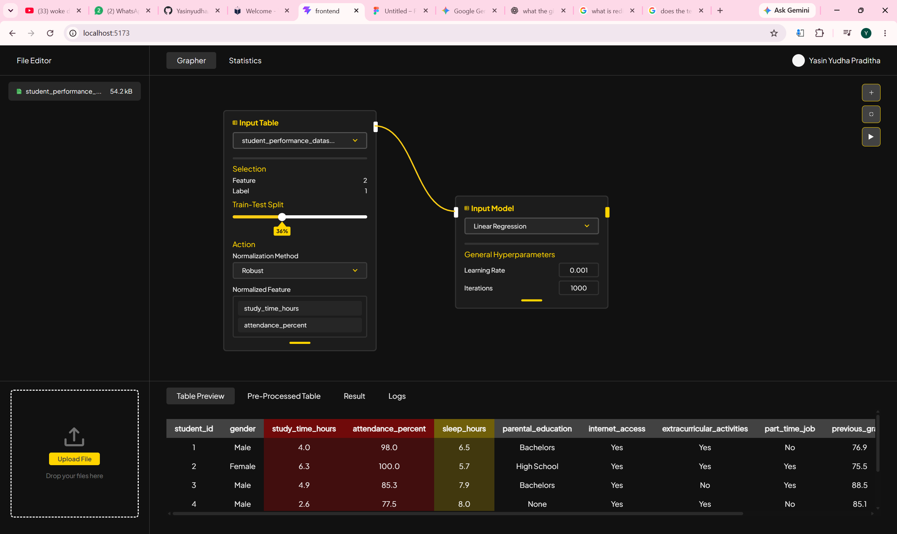

# VisualML Studio

Build, train, and evaluate Machine Learning, Deep Learning, and general generative AI models visually with no coding required.

Our platform is an open-source platform designed to simplify AI development for everyone. Currently in v1.0.0, the project is completely free to use and actively evolving. We warmly welcome community contributions to help us make a meaningful impact.

# App Overview

Our platform is a powerful, node-based visual programming environment designed to democratize AI development. Whether you're a data science student, a researcher, or a developer looking to prototype quickly, this app allows you to construct end-to-end data pipelines and train predictive models through an intuitive drag-and-drop node interface.

Our platform simplifies the development of preprocessing scripts and complex configuration workflows through an intuitive visual interface. Users can seamlessly connect multiple data sources, configure and fine-tune model hyperparameters, customize preprocessing pipelines, and monitor execution results in real time—all without the need to manually manage complicated configuration files.

# Key Features

1. Node-Based Pipeline Architecture
2. Upload CSV and tabular datasets directly into the workspace
3. Real-time Table Preview and Pre-Processed Table inspectors to track data transformations at every step
4. Effortlessly define Features and Labels
5. Configure Train-Test Split ratios using interactive sliders
6. Apply data scaling and normalization techniques (Robust, Standard, Min-Max)
7. Choose from a variety of built-in machine learning algorithms (Linear Regression, Logistic Regression, etc.)
8. Fine-tune core hyperparameters like Learning Rate and Iterations on the fly
9. Dedicated Grapher and Statistics tabs to visualize model performance and training dynamics
10. Live execution Logs for debugging and tracking pipeline runs

# Tech Stack

- Frontend: React, Tailwind CSS
- Backend: Django
- Storage: Supabase